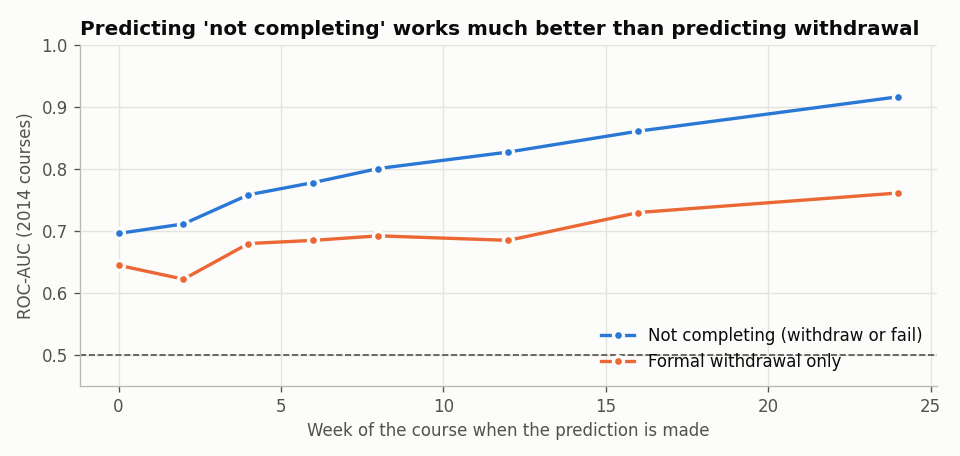
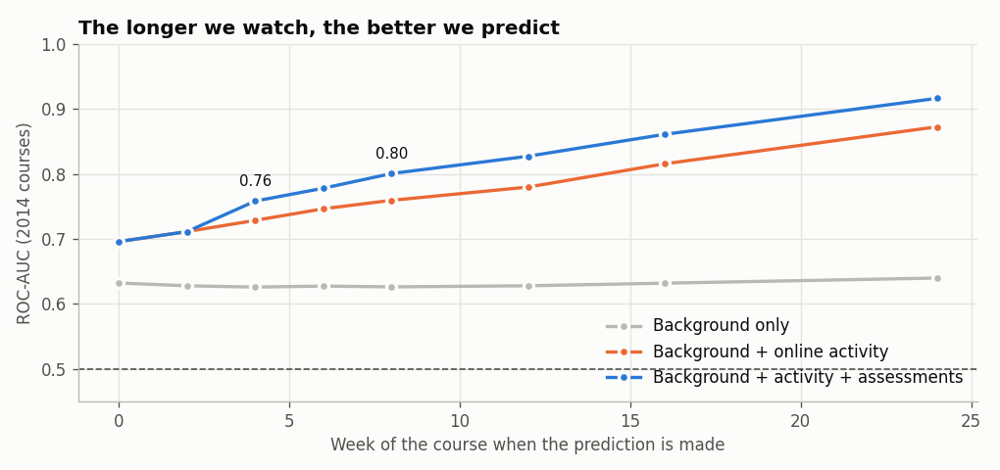

[English](README.md) | **Português**

# Identificar Alunos em Risco em Cursos Online (OULAD)

Só cerca de metade dos alunos online da Open University (Reino Unido) termina o curso com aprovação. Este projeto pergunta **quem não conclui, quando desiste e quão cedo um modelo de alerta precoce os consegue identificar**. Usa o Open University Learning Analytics Dataset: 32 593 inscrições, 7 cursos, 2013–2014 e 10,6 milhões de registos de cliques.

> Os notebooks e o código estão em inglês, para chegar a um público mais alargado.

**Dados:** [OULAD](https://analyse.kmi.open.ac.uk/open_dataset) (Kuzilek, Hlosta e Zdrahal, 2017), através do [repositório UCI](https://archive.ics.uci.edu/dataset/349).

**Resumo em linguagem simples:** [abre o dashboard online](https://ncdomingues.github.io/online-course-dropout/course-completion-at-a-glance.html) ([código](course-completion-at-a-glance.html)), uma página de síntese para quem não é técnico, em inglês e português.

**Outros projetos:** [Dados da educação em Portugal](https://github.com/ncdomingues/portuguese-education-data) · [Previsão de toxicidade Tox21](https://github.com/ncdomingues/tox21-toxicity) · [Porque param os ensaios clínicos](https://github.com/ncdomingues/clinical-trial-termination)

## Principais resultados
1. **Metade dos alunos não conclui.** 31% desistem e 22% reprovam. A privação económica (65% contra 43% não concluem), não ter qualificações anteriores (70% contra 44% dos licenciados), estar a repetir o curso e ter uma carga de trabalho elevada aumentam o risco.
2. **A janela para agir é curta.** 30% das desistências acontecem antes de o curso começar, e metade até ao dia 27. Quem não entrega o primeiro trabalho (por volta do dia 22) quase nunca é aprovado: menos de 1 em cada 20.
3. **Muitos alunos desligam-se em silêncio.** Entre os alunos ainda inscritos na semana 8 que não entraram na plataforma nessa semana, 47% acabam por reprovar e só 21% anulam formalmente a inscrição. Um modelo que só prevê desistências formais não os vê.

   

4. **O comportamento pesa mais do que o perfil.** O perfil sozinho prevê mal (ROC-AUC 0,63). Juntando a atividade online e os trabalhos, chega a **0,76 na semana 4** e **0,80 na semana 8**, com o modelo treinado nos cursos de 2013 e testado nos de 2014.

   

5. **Funciona na prática.**
   - Na semana 8, cerca de 8 em cada 10 alunos do quinto de maior risco não concluem.
   - O modelo funciona bem num curso que nunca viu no treino (ROC-AUC 0,83).
6. **Equidade: é preciso olhar por baixo dos números.**
   - À primeira vista, os alertas pareciam menos certeiros para as mulheres (precisão de 67% contra 89%).
   - A causa é a mistura de cursos. As mulheres são 80–88% dos alunos de dois cursos de ciências sociais onde uma ordenação única sinaliza demais (BBB) ou nunca sinaliza ninguém (GGG).
   - Ordenar os alunos **dentro de cada curso** reduz a diferença (78% contra 88%) e melhora o modelo no geral.

## Notas de método
- **Fotografias no tempo:** para cada dia de previsão, as variáveis usam só dados até esse dia. Ficam de fora os alunos que já tinham desistido ou que ainda não se tinham inscrito.
- **Treinar no ano anterior, prever o seguinte:** treino com as edições de 2013 e teste com as de 2014.

## Estrutura
```
src/build_dataset.py     descarrega o OULAD; cria tabelas de alunos, cliques diários por tipo de atividade e trabalhos
src/features.py          snapshot(dia): variáveis e alvos para todos os alunos ainda inscritos num dado dia
src/style.py             estilo comum dos gráficos
notebooks/01_explore_oulad.ipynb    resultados, perfil, momento da desistência, curvas de atividade, desligamento silencioso
notebooks/02_early_warning.ipynb    escolha do alvo, AUC ao longo do tempo, vista do tutor, importância das variáveis, curso novo, equidade
figures/                 gráficos exportados
course-completion-at-a-glance.html   dashboard em linguagem simples
```

## Como correr
```bash
pip install -r requirements.txt
python src/build_dataset.py     # descarrega 47 MB, cerca de um minuto
jupyter notebook notebooks/
```

## Limitações
- Uma só universidade, em 2013–2014. O ensino online mudou desde então.
- Os cliques são uma medida grosseira da aprendizagem: há alunos que estudam com material descarregado ou impresso.
- Um modelo só mostra quem está em risco. Saber se contactar os alunos sinalizados ajuda exigiria uma experiência.
